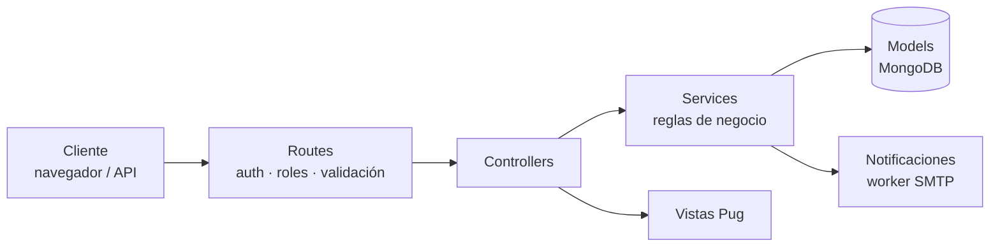
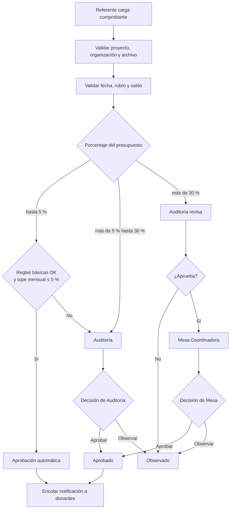
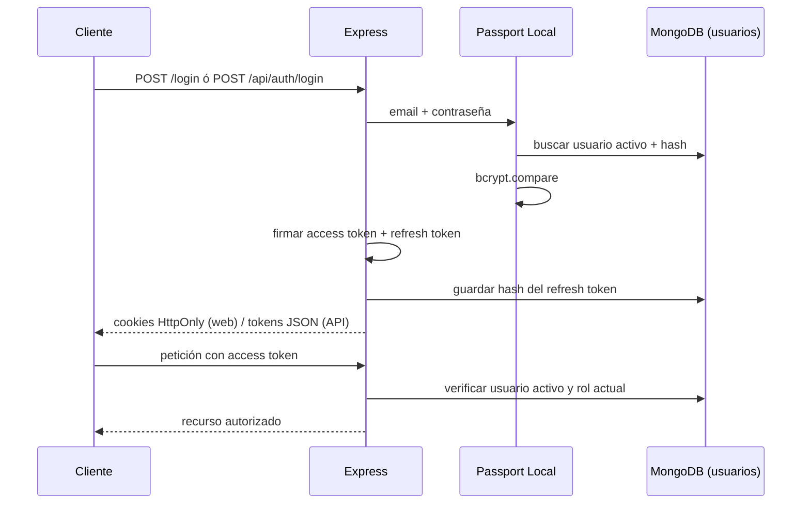
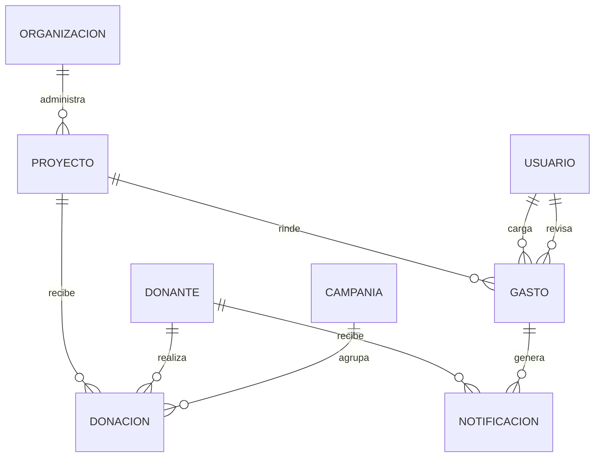

<div align="center">

# SumarImpacto — Backend

**Plataforma de transparencia y rendición de cuentas para donaciones a organizaciones sociales**

Trabajo Práctico Integrador — **Desarrollo Web Backend (DSWB)**
IFTS N° 29 · Comisión A · 2.º Cuatrimestre 2026

</div>

---

## Tabla de contenidos

1. [Descripción](#descripción)
2. [Funcionalidades principales](#funcionalidades-principales)
3. [Stack tecnológico](#stack-tecnológico)
4. [Arquitectura](#arquitectura)
5. [Inicio rápido](#inicio-rápido)
6. [Variables de entorno](#variables-de-entorno)
7. [Scripts disponibles](#scripts-disponibles)
8. [Roles y permisos](#roles-y-permisos)
9. [Circuito de rendición de gastos (RF-02)](#circuito-de-rendición-de-gastos-rf-02)
10. [Autenticación](#autenticación)
11. [Interfaz web](#interfaz-web)
12. [API REST](#api-rest)
13. [Modelo de datos](#modelo-de-datos)
14. [Seguridad](#seguridad)
15. [Pruebas](#pruebas)
16. [Migración desde la versión 1.0](#migración-desde-la-versión-10)
17. [Estructura del proyecto](#estructura-del-proyecto)
18. [Documentación adicional](#documentación-adicional)
19. [Solución de problemas](#solución-de-problemas)
20. [Alcance y limitaciones conocidas](#alcance-y-limitaciones-conocidas)
21. [Bibliografía](#bibliografía)
22. [Equipo](#equipo)

---

## Descripción

**SumarImpacto** es el backend de una red que conecta **donantes** con **organizaciones sociales** y permite
que cada donación se pueda seguir de punta a punta: desde que ingresa a un proyecto hasta que se rinde en
gastos respaldados con comprobantes.

El sistema resuelve tres problemas concretos:

- **Trazabilidad:** cada proyecto tiene presupuesto, período y rubros aprobados, y su saldo se calcula a
  partir de las donaciones recibidas y los gastos rendidos.
- **Control:** las rendiciones de gastos pasan por un circuito de aprobación que depende del porcentaje que
  representan sobre el presupuesto, con separación de funciones entre quien carga y quien aprueba.
- **Transparencia hacia el donante:** cuando una rendición se aprueba, se notifica por correo a los donantes
  que financiaron el proyecto, con enlaces firmados al comprobante.

El proyecto expone **una interfaz web** (vistas Pug con formularios) y **una API REST** protegida con JWT,
ambas sobre la misma lógica de negocio.

> **Versión 1.1.** Respecto de la entrega anterior se agregaron autenticación con Passport + JWT, control de
> acceso por roles, circuito de rendición con carga de comprobantes, campañas con reportes en PDF, cola de
> notificaciones por correo y endurecimiento de seguridad HTTP.

---

## Funcionalidades principales

| Módulo | Qué hace |
| --- | --- |
| **Proyectos y organizaciones** | ABM de organizaciones y proyectos con presupuesto total, período y rubros aprobados. Cálculo de saldo disponible. |
| **Donantes y donaciones** | ABM de donantes (individuales o corporativos) y donaciones asociadas a proyecto y/o campaña. Una donación ya utilizada no se puede modificar. |
| **Rendición de gastos** | Los referentes territoriales cargan gastos con comprobante (JPG, PNG, WEBP o PDF, hasta 5 MB). Las reglas de negocio determinan si se aprueba automáticamente o si requiere revisión. |
| **Revisión y aprobación** | Auditoría y Mesa Coordinadora aprueban u observan rendiciones según el umbral. Nadie puede resolver una rendición que cargó. |
| **Campañas** | Metas y fechas por campaña, con reporte agregado (total recaudado, cantidad de donaciones, avance de meta) y exportación a PDF. |
| **Notificaciones** | Cola persistente (outbox) con reintentos, agrupación por destinatario y preferencia de frecuencia (inmediata, semanal o mensual). |
| **Administración de usuarios** | Alta, listado y activación/desactivación de usuarios con rol y organización. |
| **Guía de uso** | Pantalla `/tutorial` con las tareas principales por rol. |

---

## Stack tecnológico

| Capa | Tecnología |
| --- | --- |
| Runtime | Node.js ≥ 20 (ES Modules) |
| Framework web | Express 4 |
| Base de datos | MongoDB + Mongoose 9 |
| Vistas | Pug + `method-override` (PUT/DELETE desde formularios HTML) |
| Autenticación | Passport (`passport-local` + `passport-jwt`), `jsonwebtoken`, `bcryptjs` |
| Validación | `express-validator` (entrada) + validaciones de esquema Mongoose |
| Seguridad HTTP | `helmet`, `cors` (lista de orígenes), `express-rate-limit`, cookies `HttpOnly` |
| Archivos | `multer` (en memoria) con validación de tipo MIME y firma binaria |
| Correo | `nodemailer` (SMTP) |
| Reportes | `pdfkit` |
| Pruebas | Runner nativo de Node (`node --test`) |

---

## Arquitectura

El proyecto sigue una organización **MVC con capa de servicios**, de modo que las rutas no contienen lógica
de negocio.



- **Routes:** definen endpoints, autenticación, roles y validación de entrada.
- **Controllers:** traducen HTTP a operaciones del dominio y preparan la respuesta (JSON o Pug).
- **Services:** concentran saldo de proyectos, validación de relaciones, circuito de rendiciones y notificaciones.
- **Models:** esquemas Mongoose con validaciones de invariantes.
- **Middleware:** Passport JWT, control de roles, subida de archivos, manejo centralizado de errores, logging y
  protección de origen.

Todos los controladores asincrónicos usan `asyncHandler` y los errores de dominio se expresan con `ApiError`
(status HTTP + código estable). Un único `errorHandler` responde JSON uniforme en la API y renderiza
`views/error.pug` en la web; en producción no expone stack traces.

---

## Inicio rápido

### Requisitos previos

- [Node.js](https://nodejs.org/) **20 o superior**
- [MongoDB](https://www.mongodb.com/try/download/community) local o una base en [MongoDB Atlas](https://www.mongodb.com/atlas)
- Git

### 1. Clonar e instalar dependencias

```bash
git clone https://github.com/ivanshifman/TP-BACKEND-SUMAR_IMPACTO.git
cd TP-BACKEND-SUMAR_IMPACTO
npm install
```

### 2. Configurar el entorno

```bash
cp .env.example .env
```

Editá `.env` y completá como mínimo `MONGODB_URI`, los dos secretos JWT y las credenciales del primer
administrador. Para generar secretos seguros:

```bash
openssl rand -base64 48
```

> Los dos secretos JWT deben tener **al menos 32 caracteres** y ser **distintos entre sí**; el servidor se
> niega a iniciar si no se cumple.

### 3. Crear el administrador inicial

```bash
npm run create-admin
```

Usa `BOOTSTRAP_ADMIN_EMAIL` y `BOOTSTRAP_ADMIN_PASSWORD` del `.env`. La contraseña debe tener al menos
12 caracteres e incluir mayúscula, minúscula, número y símbolo.

### 4. (Opcional) Cargar datos de ejemplo

```bash
npm run seed
```

> ⚠️ **El seed borra las colecciones del dominio** (donantes, organizaciones, proyectos, donaciones, gastos,
> campañas y notificaciones) antes de cargar los datos de ejemplo. Usalo solo en una base de desarrollo.
> No elimina usuarios.

### 5. Iniciar el servidor

```bash
npm run dev      # desarrollo, con recarga automática (nodemon)
npm start        # ejecución normal
```

La aplicación queda disponible en **http://localhost:3000**:

| Recurso | URL |
| --- | --- |
| Interfaz web | http://localhost:3000/ |
| Login | http://localhost:3000/login |
| API REST | http://localhost:3000/api/… |
| Estado del servicio | http://localhost:3000/health |

> **Importante:** usá siempre la misma URL en el navegador (`localhost` **o** `127.0.0.1`, no ambas). Las
> cookies de sesión usan `SameSite=Strict` y la protección de origen valida el host.

---

## Variables de entorno

Todas se definen en `.env` (ver `.env.example`).

| Variable | Obligatoria | Por defecto | Descripción |
| --- | :---: | --- | --- |
| `MONGODB_URI` | ✅ | — | Cadena de conexión a MongoDB. |
| `PORT` | | `3000` | Puerto HTTP. |
| `NODE_ENV` | | — | `production` activa cookies `Secure` y oculta detalles de error. |
| `JWT_ACCESS_SECRET` | ✅ | — | Secreto del access token (≥ 32 caracteres). |
| `JWT_REFRESH_SECRET` | ✅ | — | Secreto del refresh token (≥ 32 caracteres, distinto del anterior). |
| `JWT_ACCESS_TTL` | | `15m` | Vigencia del access token. |
| `JWT_REFRESH_TTL` | | `7d` | Vigencia del refresh token. |
| `JWT_ISSUER` | | `sumarimpacto-api` | Claim `iss` de los tokens. |
| `JWT_AUDIENCE` | | `sumarimpacto-client` | Claim `aud` de los tokens. |
| `BOOTSTRAP_ADMIN_NAME` | | `Administrador SumarImpacto` | Nombre del primer administrador. |
| `BOOTSTRAP_ADMIN_EMAIL` | ✅ (create-admin) | — | Email del primer administrador. |
| `BOOTSTRAP_ADMIN_PASSWORD` | ✅ (create-admin) | — | Contraseña inicial (política de 12 caracteres). |
| `CORS_ORIGINS` | | `http://localhost:3000` | Orígenes permitidos, separados por coma y sin barra final. |
| `TRUST_PROXY` | | `false` | `true` solo si el servidor está detrás de un proxy confiable. |
| `APP_BASE_URL` | | — | URL base usada en los enlaces de los correos. |
| `COMPROBANTE_LINK_SECRET` | | — | Secreto de los enlaces públicos a comprobantes (≥ 32 caracteres, distinto de los JWT). |
| `SMTP_HOST` · `SMTP_PORT` · `SMTP_SECURE` | | — | Servidor SMTP. Sin estas variables, las notificaciones quedan en cola. |
| `SMTP_USER` · `SMTP_PASSWORD` · `SMTP_FROM` | | — | Credenciales y remitente SMTP. |
| `RENDICION_AUTO_MAX_PCT` | | `5` | Porcentaje máximo para aprobación automática. |
| `RENDICION_MESA_MIN_PCT` | | `30` | Porcentaje a partir del cual interviene la Mesa Coordinadora. |
| `RENDICION_AUTO_MONTHLY_CAP_PCT` | | `5` | Tope mensual acumulado de aprobaciones automáticas. |

> 🔒 **Nunca subas el archivo `.env` al repositorio.** Está pensado para quedar fuera del control de versiones
> (`.gitignore`). Si una credencial se expuso, rotala.

---

## Scripts disponibles

| Comando | Descripción |
| --- | --- |
| `npm start` | Inicia el servidor. |
| `npm run dev` | Inicia el servidor con `nodemon`. |
| `npm run create-admin` | Crea el primer usuario administrador desde las variables `BOOTSTRAP_ADMIN_*`. |
| `npm run seed` | Carga datos de ejemplo (**borra** las colecciones del dominio). |
| `npm run check` | Verifica la sintaxis de todos los archivos JS y compila todas las plantillas Pug. |
| `npm test` | Ejecuta las pruebas unitarias (`node --test`). |
| `npm run migrate-v1.1` | Migra datos de la versión 1.0 a la 1.1 (ver [migración](#migración-desde-la-versión-10)). |

---

## Roles y permisos

El sistema define **seis roles**. La autorización se aplica en el servidor mediante middleware de rol y
consultas con alcance por organización.

| Rol | Valor interno | Responsabilidad |
| --- | --- | --- |
| Administrador del sistema | `administrador` | Gestión técnica: usuarios, organizaciones, lectura global. **No** suplanta decisiones funcionales. |
| Referente territorial | `referente_territorial` | Carga rendiciones de los proyectos de su organización. |
| Auditoría | `auditoria` | Revisa rendiciones y resuelve las del rango intermedio. |
| Mesa Coordinadora | `mesa_coordinadora` | Gestiona proyectos y campañas; resuelve rendiciones de alto monto. |
| Administración | `administracion` | Gestiona donantes y donaciones; consulta rendiciones (solo lectura). |
| Trabajo Social | `trabajo_social` | Gestiona organizaciones y proyectos. |

### Matriz resumida

| Recurso / acción | Referente | Auditoría | Mesa | Administración | Trabajo Social | Administrador |
| --- | :---: | :---: | :---: | :---: | :---: | :---: |
| Ver proyectos | Propios | Todos | Todos | Todos | Todos | Todos |
| Cargar comprobantes | Propios | — | — | — | — | — |
| Ver rendiciones | Propias | Todas | Todas | Todas (lectura) | — | Todas (lectura) |
| Aprobar / observar rendiciones de 5 % a 30 % | — | ✅ | — | — | — | — |
| Revisar rendiciones > 30 % | — | ✅ | — | — | — | — |
| Resolver rendiciones > 30 % | — | — | ✅ | — | — | — |
| Gestionar proyectos | — | — | ✅ | — | ✅ | ✅ |
| Gestionar organizaciones | — | — | — | — | ✅ | ✅ |
| Gestionar donantes y donaciones | — | — | — | ✅ | — | ✅ |
| Gestionar campañas | — | — | ✅ | — | — | ✅ |
| Gestionar usuarios | — | — | — | — | — | ✅ |

> **Nota de diseño:** el administrador técnico no puede cargar gastos ni aprobar rendiciones. Esa separación
> de funciones es intencional: quien administra el sistema no puede alterar el circuito de control.

---

## Circuito de rendición de gastos (RF-02)

Cada gasto cargado se evalúa contra el presupuesto total del proyecto. Las **reglas básicas** son: fecha dentro
del período del proyecto, rubro incluido entre los aprobados y monto no superior al saldo disponible.



**Estados de un gasto:** `recibido` → `en_revision` → `pendiente_mesa` → `aprobado` / `observado`.

Los umbrales (5 %, 30 % y tope mensual del 5 %) son **parametrizables** mediante variables de entorno. Los
valores iniciales provienen del relevamiento de requerimientos y deben confirmarse con la Mesa Coordinadora.

**Controles adicionales:** un usuario no puede aprobar ni observar una rendición que cargó; un gasto que
supera el saldo del proyecto se rechaza con `409`; un referente solo puede cargar comprobantes de proyectos de
su propia organización.

---

## Autenticación

Se usa **Passport Local** para el login y **Passport JWT** para proteger las rutas.



- **Access token:** 15 minutos por defecto. Se acepta por cookie `HttpOnly` (web) o header
  `Authorization: Bearer <token>` (API).
- **Refresh token:** 7 días, con **rotación** en cada uso. En la base solo se guarda su hash SHA-256.
- **Rol siempre actualizado:** en cada petición se consulta el usuario en la base; no se confía en el rol
  embebido en el token. Desactivar un usuario o cambiarle el rol tiene efecto inmediato.
- **Contraseñas:** hash con `bcrypt` (12 rondas), mínimo 12 caracteres.
- **Límite de intentos:** 8 intentos de login cada 15 minutos.

### Ejemplo con la API

```bash
# 1. Login
curl -X POST http://localhost:3000/api/auth/login \
  -H "Content-Type: application/json" \
  -d '{"email":"admin@sumarimpacto.local","password":"<tu-contraseña>"}'

# 2. Usar el access token
curl http://localhost:3000/api/auth/me \
  -H "Authorization: Bearer <accessToken>"

# 3. Renovar tokens
curl -X POST http://localhost:3000/api/auth/refresh \
  -H "Content-Type: application/json" \
  -d '{"refreshToken":"<refreshToken>"}'
```

---

## Interfaz web

Todas las rutas (salvo `/login`, `/health` y los enlaces públicos de comprobantes) requieren sesión.

| Ruta | Descripción | Roles |
| --- | --- | --- |
| `/login` · `POST /logout` | Acceso y cierre de sesión | Público |
| `/` | Listado de proyectos con su saldo disponible | Todos |
| `/proyectos/nuevo` · `/proyectos/:id/editar` | Alta y edición de proyectos | Admin, Mesa, Trabajo Social |
| `/proyectos/:id` | Detalle: donaciones, gastos y acciones | Todos (referente: solo propios) |
| `/donantes` · `/donantes/:id` | Listado y detalle de donantes | Admin, Administración, Auditoría, Mesa |
| `/organizaciones` · `/organizaciones/:id` | Listado y detalle de organizaciones | Admin, Trabajo Social, Mesa, Auditoría, Administración |
| `/donaciones/nueva` · `/donaciones/:id/editar` | Alta y edición de donaciones | Admin, Administración |
| `/gastos` · `/gastos/nuevo` | Listado de gastos y alta de rendición | Listado: según rol · Alta: Referente |
| `/rendiciones` | Bandeja de rendiciones y revisión | Admin, Referente, Auditoría, Mesa, Administración |
| `/admin` · `/admin/usuarios` | Panel y gestión de usuarios | Administrador |
| `/admin/campanias` · `/admin/campanias/:id/reporte` | Campañas y reporte (`.pdf` disponible) | Admin, Mesa, Administración |
| `/tutorial` | Guía de uso por rol | Todos |
| `/health` | Estado del servicio | Público |

Los gastos solo admiten **alta** por diseño: no se editan ni eliminan, para no romper la consistencia del saldo
ya calculado.

---

## API REST

Prefijo `/api`. Todas las rutas, salvo `/api/auth/login` y `/api/auth/refresh`, exigen autenticación.
Las respuestas de error tienen un formato uniforme:

```json
{
  "error": true,
  "codigo": "FORBIDDEN",
  "mensaje": "No tenés permisos para realizar esta acción."
}
```

| Recurso | Endpoints |
| --- | --- |
| **Auth** | `POST /api/auth/login` · `POST /api/auth/refresh` · `POST /api/auth/logout` · `GET /api/auth/me` |
| **Usuarios** | `GET /api/usuarios` · `POST /api/usuarios` *(solo Administrador)* |
| **Donantes** | `GET, POST /api/donantes` · `GET, PUT, DELETE /api/donantes/:id` |
| **Organizaciones** | `GET, POST /api/organizaciones` · `GET, PUT, DELETE /api/organizaciones/:id` |
| **Proyectos** | `GET, POST /api/proyectos` · `GET, PUT, DELETE /api/proyectos/:id` · `GET /api/proyectos/:id/saldo` · `GET /api/proyectos/:id/donaciones` · `GET /api/proyectos/:id/gastos` |
| **Donaciones** | `GET, POST /api/donaciones` · `GET, PUT, DELETE /api/donaciones/:id` |
| **Gastos** | `GET, POST /api/gastos` *(POST multipart con comprobante)* · `GET /api/gastos/:id` · `PATCH /api/gastos/:id/revision` |

### Códigos de estado

| Código | Significado |
| --- | --- |
| `400` | Datos inválidos o identificador mal formado |
| `401` | Sin autenticación, token inválido o vencido |
| `403` | Sin permiso para la acción, o origen no autorizado |
| `404` | Recurso inexistente |
| `409` | Conflicto (email duplicado, saldo insuficiente, etc.) |
| `413` | Contenido demasiado grande |
| `429` | Demasiadas solicitudes |

---

## Modelo de datos



| Entidad | Descripción |
| --- | --- |
| `Usuario` | Cuenta con rol, organización (para referentes), estado activo y hash del refresh token. |
| `Organizacion` | Entidad social que ejecuta proyectos. |
| `Proyecto` | Presupuesto total, período, rubros con monto aprobado y organización responsable. |
| `Donante` | Persona o empresa, con preferencia de frecuencia de notificación. |
| `Donacion` | Monto aportado por un donante a un proyecto y/o campaña. |
| `Campania` | Meta, fechas y estado; agrupa donaciones para el reporte. |
| `Gasto` | Rendición individual: comprobante, rubro, porcentaje del presupuesto, estado y actores de auditoría. |
| `Notificacion` | Outbox persistente de eventos para envío por correo. |

Las relaciones usan `ObjectId` nativo de MongoDB mediante `ref` de Mongoose.

**Validaciones en dos niveles:**

- **Entrada:** `express-validator` en las rutas.
- **Persistencia y negocio:** validaciones de esquema Mongoose y reglas en los servicios (existencia de
  relaciones, saldo disponible, donación no modificable si ya fue utilizada).

---

## Seguridad

| Control | Implementación |
| --- | --- |
| Contraseñas | `bcrypt` con 12 rondas; política de 12 caracteres mínimo |
| Sesión | JWT firmado (HS256) con `issuer` y `audience`; cookies `HttpOnly`, `SameSite=Strict` y `Secure` en producción |
| Refresh token | Rotación en cada uso; solo se persiste su hash |
| Autorización | Middleware de roles + aislamiento por organización para referentes |
| Cabeceras HTTP | `helmet` (con `Referrer-Policy: same-origin`) |
| CORS y origen | Lista de orígenes permitidos y verificación de `Origin` en peticiones que modifican datos |
| Fuerza bruta | Límite de 8 intentos de login por 15 minutos y 300 solicitudes generales por 15 minutos |
| Archivos | Máximo 5 MB, validación de tipo MIME **y** firma binaria del archivo |
| Enlaces públicos | Comprobantes firmados con HMAC, vigencia de 90 días, solo para rendiciones aprobadas |
| Errores | Respuestas uniformes; en producción no se exponen stack ni mensajes internos |
| Secretos | Validados al iniciar (longitud mínima y distintos entre sí) |

---

## Pruebas

```bash
npm run check   # sintaxis de todos los .js + compilación de todas las vistas Pug
npm test        # pruebas unitarias
```

Las pruebas automatizadas cubren las **reglas del circuito de rendición (RF-02)**:

- aprobación automática hasta el 5 % cuando se cumplen las reglas básicas y el tope mensual;
- derivación a Auditoría cuando el acumulado automático mensual supera el 5 %;
- envío a Auditoría entre el 5 % y el 30 %;
- intervención de Mesa Coordinadora por encima del 30 %;
- no aprobar automáticamente comprobantes que incumplen reglas básicas;
- rechazo de presupuestos o importes inválidos;
- parametrización de los umbrales.

El plan completo de pruebas de integración (autenticación, autorización por rol, carga de archivos,
notificaciones, reportes y manejo de errores) está en [`docs/TESTING.md`](docs/TESTING.md).

---

## Migración desde la versión 1.0

Si tenés datos de la versión anterior, **hacé un backup antes de migrar** y probá primero en un entorno de
prueba.

```bash
npm run migrate-v1.1
```

El script convierte contraseñas en texto plano a hashes bcrypt, activa cuentas sin el campo `activo` y revoca
refresh tokens. **No inventa datos:** informa qué proyectos no tienen presupuesto, período o rubros, y qué
referentes no tienen organización asignada, para que se completen manualmente. Los detalles están en
[`docs/MIGRATION.md`](docs/MIGRATION.md).

---

## Estructura del proyecto

```text
sumarimpacto-backend/
├── server.js                  # Punto de entrada: valida secretos, conecta a la base y levanta Express
├── .env.example               # Plantilla de variables de entorno
├── data/
│   └── seed.js                # Datos de ejemplo (npm run seed)
├── docs/                      # Arquitectura, migración, pruebas e informe técnico
├── public/css/                # Estilos
├── scripts/
│   ├── check.js               # Verificación de sintaxis JS y plantillas Pug
│   ├── create-admin.js        # Creación del administrador inicial
│   └── migrate-v1.1.js        # Migración de 1.0 a 1.1
├── src/
│   ├── app.js                 # Configuración de Express y middleware global
│   ├── config/                # Conexión a DB, Passport, seguridad y reglas de rendición
│   ├── controllers/           # Controladores de la API y de las vistas
│   ├── middleware/            # Auth/roles, errores, logger, upload, validación, protección de origen
│   ├── models/                # Esquemas Mongoose
│   ├── routes/                # Rutas de la API, vistas, auth y administración
│   ├── services/              # Lógica de negocio (saldo, donaciones, rendiciones, notificaciones)
│   └── utils/                 # ApiError, asyncHandler, tokens, reglas de rendición
├── tests/                     # Pruebas unitarias
└── views/                     # Vistas Pug (layout, admin, auth, proyectos, donantes, gastos, etc.)
```

---

## Documentación adicional

| Documento | Contenido |
| --- | --- |
| [`docs/ARCHITECTURE.md`](docs/ARCHITECTURE.md) | Decisiones de arquitectura, diagramas y flujos |
| [`docs/MIGRATION.md`](docs/MIGRATION.md) | Guía de migración 1.0 → 1.1 |
| [`docs/TESTING.md`](docs/TESTING.md) | Plan y evidencia de pruebas |
| [`docs/ENTREGA-DSWB.md`](docs/ENTREGA-DSWB.md) | Guía para la documentación y defensa de la entrega |
| [`docs/Informe_Tecnico_Backend_1.1.pdf`](docs/Informe_Tecnico_Backend_1.1.pdf) | Informe técnico de la versión 1.1 |

---

## Solución de problemas

| Síntoma | Causa probable | Solución |
| --- | --- | --- |
| El servidor no inicia: "Configurá secretos de al menos 32 caracteres" | Falta o es corto algún secreto JWT | Generalos con `openssl rand -base64 48` y verificá que sean distintos. |
| **403** al ingresar: "El origen de la solicitud no está autorizado" | Entrás por una URL que no está en `CORS_ORIGINS` | Agregá el origen exacto a `CORS_ORIGINS` (sin barra final) y reiniciá. |
| El login "no hace nada" o vuelve a `/login` | Mezclás `localhost` y `127.0.0.1` (cookies `SameSite=Strict`) | Usá una sola URL de forma consistente. |
| **403** "No tenés permisos para realizar esta acción" | El rol no tiene acceso a esa acción | Revisá la [matriz de roles](#roles-y-permisos). Por ejemplo, el administrador no carga gastos. |
| **429** al ingresar | Superaste los 8 intentos de login en 15 minutos | Esperá 15 minutos. |
| Las notificaciones no se envían | SMTP sin configurar | Completá las variables `SMTP_*`; mientras tanto los eventos quedan en cola. |
| `create-admin`: "Ya existe un usuario con ese email" | El administrador ya fue creado | Ingresá con ese usuario o usá otro email. |

---

## Alcance y limitaciones conocidas

- Los **umbrales de aprobación** (5 % / 30 % / tope mensual) son valores iniciales a confirmar con la Mesa
  Coordinadora.
- Los **comprobantes se guardan como Buffer en MongoDB** (máximo 5 MB). Es adecuado para el volumen de esta
  entrega; en producción a gran escala conviene almacenamiento de objetos (S3 o compatible) y dejar en MongoDB
  solo los metadatos.
- El **worker de notificaciones** corre dentro del proceso Node. Para alta disponibilidad requiere un worker
  externo y una cola dedicada.
- Los estados visibles para el donante y el canal formal de comunicación quedan fuera de los incrementos
  actuales.
- Las pruebas de integración descriptas en `docs/TESTING.md` son un plan; se deben ejecutar y registrar con
  evidencia real antes de la entrega.

---

## Bibliografía

- Mongoose. *Documentación oficial*. <https://mongoosejs.com/docs/guide.html>
- MongoDB. *Documentación oficial*. <https://www.mongodb.com/docs/manual/>
- Express.js. *Using template engines with Express*. <https://expressjs.com/es/guide/using-template-engines/>
- Pug. *Documentación oficial*. <https://pugjs.org/api/getting-started.html>
- Node.js. *ECMAScript Modules*. <https://nodejs.org/api/esm.html>
- Passport. *Documentación oficial*. <https://www.passportjs.org/docs/>
- OWASP. *Cheat Sheet Series*. <https://cheatsheetseries.owasp.org/>

---

## Equipo

| Integrante |
| --- |
| Iván Ezequiel Shifman |
| Ángel Sabato |
| Flavio Rinaldi |
| Marcelo Zárate |

**Institución:** IFTS N° 29 · **Materia:** Desarrollo Web Backend · **Comisión A** · 2.º Cuatrimestre 2026

**Repositorio:** <https://github.com/ivanshifman/TP-BACKEND-SUMAR_IMPACTO>