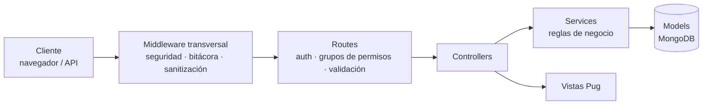
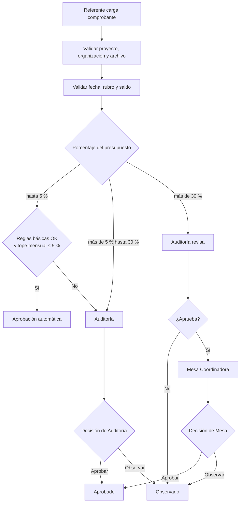
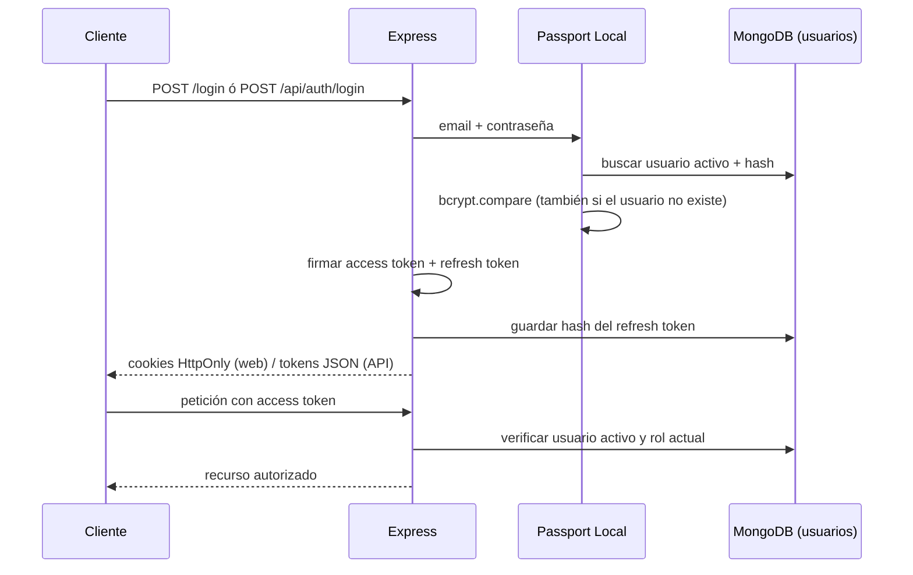
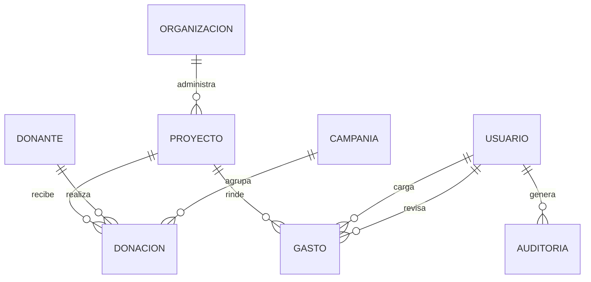

<div align="center">

# SumarImpacto — Backend

**Plataforma de transparencia y rendición de cuentas para donaciones a organizaciones sociales**

Trabajo Práctico Integrador — **Desarrollo Web Backend (DSWB)**
IFTS N° 29 · Comisión A · 2.º Cuatrimestre 2026

</div>

---

## Tabla de contenidos

1. [Descripción](#descripción)
2. [Funcionalidades principales](#funcionalidades-principales)
3. [Stack tecnológico](#stack-tecnológico)
4. [Arquitectura y patrones](#arquitectura-y-patrones)
5. [Inicio rápido](#inicio-rápido)
6. [Variables de entorno](#variables-de-entorno)
7. [Scripts disponibles](#scripts-disponibles)
8. [Roles y permisos](#roles-y-permisos)
9. [Circuito de rendición de gastos (RF-02)](#circuito-de-rendición-de-gastos-rf-02)
10. [Autenticación y cuentas](#autenticación-y-cuentas)
11. [Interfaz web](#interfaz-web)
12. [API REST](#api-rest)
13. [Modelo de datos](#modelo-de-datos)
14. [Seguridad](#seguridad)
15. [Bitácora de auditoría](#bitácora-de-auditoría)
16. [Pruebas](#pruebas)
17. [Migración entre versiones](#migración-entre-versiones)
18. [Estructura del proyecto](#estructura-del-proyecto)
19. [Despliegue](#despliegue)
20. [Documentación adicional](#documentación-adicional)
21. [Solución de problemas](#solución-de-problemas)
22. [Alcance y limitaciones conocidas](#alcance-y-limitaciones-conocidas)
23. [Bibliografía](#bibliografía)
24. [Equipo](#equipo)

---

## Descripción

**SumarImpacto** es el backend de una red que conecta **donantes** con **organizaciones sociales** y permite
que cada donación se pueda seguir de punta a punta: desde que ingresa a un proyecto hasta que se rinde en
gastos respaldados con comprobantes.

El sistema resuelve tres problemas concretos:

- **Trazabilidad:** cada proyecto tiene presupuesto, período y rubros aprobados, y su saldo se calcula a
  partir de las donaciones recibidas y los gastos rendidos.
- **Control:** las rendiciones de gastos pasan por un circuito de aprobación que depende del porcentaje que
  representan sobre el presupuesto, con separación de funciones entre quien carga y quien aprueba.
- **Transparencia y rendición de cuentas:** cada rendición aprobada queda registrada con su comprobante,
  responsable y fecha, y toda acción que modifica datos queda en una bitácora de auditoría.

El proyecto expone **una interfaz web** (vistas Pug con formularios) y **una API REST** protegida con JWT,
ambas sobre la misma lógica de negocio.

> **Versión 1.2.** Respecto de la 1.1: gestión completa de cuentas (cambio y restablecimiento de contraseña,
> edición de rol, cambio obligatorio en el primer ingreso), bitácora de auditoría, ciclo de vida de proyectos
> (activar/desactivar), nuevas validaciones de negocio, control de concurrencia, Política de Seguridad de
> Contenido (CSP), documentación OpenAPI y soporte de Docker y CI. Ver [`CHANGELOG.md`](CHANGELOG.md).

---

## Funcionalidades principales

| Módulo | Qué hace |
| --- | --- |
| **Proyectos y organizaciones** | ABM con presupuesto total, período y rubros aprobados; saldo disponible calculado. Los proyectos se pueden **desactivar** sin perder su historial. |
| **Donantes y donaciones** | ABM de donantes (individuales o corporativos) y donaciones a un proyecto y/o campaña. Una donación de un proyecto con rendiciones no se puede modificar ni eliminar. |
| **Rendición de gastos** | Los referentes territoriales cargan gastos con comprobante (JPG, PNG, WEBP o PDF, hasta 5 MB). Las reglas de negocio determinan si se aprueba automáticamente o si requiere revisión. |
| **Revisión y aprobación** | Auditoría y Mesa Coordinadora aprueban u observan rendiciones según el umbral. Nadie puede resolver una rendición que cargó. |
| **Campañas** | Metas y fechas por campaña, con reporte (total recaudado, cantidad de donaciones, avance de meta) y exportación a PDF. |
| **Cuentas de usuario** | Alta, edición de rol y organización, activación/desactivación, **restablecimiento de contraseña** por el administrador y **cambio de contraseña propio**. Las cuentas nuevas deben cambiar su contraseña en el primer ingreso. |
| **Bitácora de auditoría** | Registro de quién hizo qué y cuándo, consultable por Auditoría y el administrador. |
| **Guía de uso** | Pantalla `/tutorial` con las tareas principales por rol. |

---

## Stack tecnológico

| Capa | Tecnología |
| --- | --- |
| Runtime | Node.js ≥ 20 (ES Modules) |
| Framework web | Express 4 |
| Base de datos | MongoDB + Mongoose 9 |
| Vistas | Pug + `method-override` (PUT/DELETE desde formularios HTML) |
| Autenticación | Passport (`passport-local` + `passport-jwt`), `jsonwebtoken`, `bcryptjs` |
| Validación | `express-validator` (entrada) + validaciones de esquema Mongoose + reglas en servicios |
| Seguridad HTTP | `helmet` (con CSP), `cors`, `express-rate-limit`, cookies `HttpOnly` |
| Archivos | `multer` (en memoria) con validación de tipo MIME y firma binaria |
| Reportes | `pdfkit` |
| Pruebas | Jest 30 (ESM) + Supertest + `mongodb-memory-server-core` |
| Operación | Docker (imagen multietapa, usuario no root) y GitHub Actions |

---

## Arquitectura y patrones

El proyecto sigue una organización **MVC con capa de servicios**: las rutas y los controladores no contienen
lógica de negocio.



- **Routes:** definen endpoints, autenticación, permisos (`permitirGrupo`) y validación de entrada.
- **Controllers:** traducen HTTP a operaciones del dominio y preparan la respuesta (JSON o Pug). La API y la
  web comparten los mismos servicios, por lo que aplican exactamente las mismas reglas.
- **Services:** `ProyectoService`, `DonacionService`, `RendicionService`, `UsuarioService`,
  `CampaniaService` y `AuditoriaService` concentran las reglas de negocio.
- **Models:** esquemas Mongoose con validaciones de invariantes.
- **Utils:** funciones puras y sin dependencias de Express (política de contraseñas, reglas de rendición y de
  presupuesto, fechas, exclusión mutua), fáciles de probar de forma aislada.

**Patrones y decisiones de diseño**

| Patrón | Dónde se aplica |
| --- | --- |
| **Fuente única de permisos** | `src/config/permisos.js` define grupos de roles. Las rutas usan `permitirGrupo("…")` y las vistas `puede("…")`; un grupo inexistente falla al iniciar en lugar de otorgar acceso. |
| **Capa de servicios** | La lógica de negocio vive en servicios compartidos entre la API y la web. |
| **Funciones puras para las reglas** | `reglasRendicion`, `reglasProyecto`, `politicaPassword`: sin E/S, con pruebas unitarias directas. |
| **Manejo centralizado de errores** | `ApiError` (status + código estable) y un único `errorHandler`: JSON uniforme en la API y página de error en la web. |
| **Middleware transversal** | Bitácora, sanitización de entrada, protección de origen y límites de tasa se aplican una sola vez, antes de las rutas. |
| **Inyección de dependencias en middleware** | `auditar({ registrar })` recibe la función de registro, lo que permite probarlo sin base de datos. |
| **Control de concurrencia** | Exclusión mutua por proyecto al verificar saldo y crear un gasto, y concurrencia optimista de Mongoose en las rendiciones. |
| **Consultas agrupadas** | Los saldos de varios proyectos se calculan con tres consultas agregadas, no tres por proyecto. |
| **Seguridad por defecto** | Sin secretos por defecto, falla ante configuración insegura, mínimo privilegio en el contenedor. |

---

## Inicio rápido

### Requisitos previos

- [Node.js](https://nodejs.org/) **20 o superior**
- [MongoDB](https://www.mongodb.com/try/download/community) local o una base en [MongoDB Atlas](https://www.mongodb.com/atlas)
- Git

### 1. Clonar e instalar dependencias

```bash
git clone https://github.com/ivanshifman/TP-BACKEND-SUMAR_IMPACTO.git
cd TP-BACKEND-SUMAR_IMPACTO
npm install
```

### 2. Configurar el entorno

```bash
cp .env.example .env
```

Editá `.env` y completá como mínimo `MONGODB_URI`, los dos secretos JWT y las credenciales del primer
administrador. Para generar secretos seguros:

```bash
openssl rand -base64 48
```

Para usar MongoDB Atlas, copiá la URI de conexión del cluster en `MONGODB_URI` y autorizá la IP de salida
de tu entorno en **Network Access** de Atlas. No compartas la URI ni subas `.env` al repositorio.

> Los dos secretos JWT deben tener **al menos 32 caracteres** y ser **distintos entre sí**; el servidor se
> niega a iniciar si no se cumple.

### 3. Crear el administrador inicial

```bash
npm run create-admin
```

Usa `BOOTSTRAP_ADMIN_EMAIL` y `BOOTSTRAP_ADMIN_PASSWORD` del `.env`. La contraseña debe cumplir la
[política de contraseñas](#autenticación-y-cuentas). **En su primer ingreso el sistema le pedirá elegir una
contraseña propia.**

### 4. (Opcional) Cargar datos de ejemplo

```bash
npm run seed
```

> ⚠️ **El seed borra las colecciones del dominio** (donantes, organizaciones, proyectos, donaciones, gastos
> y campañas) antes de cargar los datos de ejemplo. Usalo solo en una base de desarrollo.
> No elimina usuarios.

### 5. Iniciar el servidor

```bash
npm run dev      # desarrollo, con recarga automática (nodemon)
npm start        # ejecución normal
```

La aplicación queda disponible en **http://localhost:3000**:

| Recurso | URL |
| --- | --- |
| Interfaz web | http://localhost:3000/ |
| Login | http://localhost:3000/login |
| API REST | http://localhost:3000/api/… (contrato en [`docs/openapi.yaml`](docs/openapi.yaml)) |
| Estado del servicio | http://localhost:3000/health |

> **Importante:** usá siempre la misma URL en el navegador (`localhost` **o** `127.0.0.1`, no ambas). Las
> cookies de sesión son `SameSite=Strict` y no viajan entre ambos nombres.

### Alternativa: Docker

```bash
cp .env.example .env                               # completá los secretos
docker compose up --build                          # aplicación + MongoDB
docker compose run --rm app node scripts/create-admin.js
```

`docker-compose.yml` levanta MongoDB y la aplicación con una sola orden. Por defecto usa `NODE_ENV=development`
para poder ingresar por `http://localhost:3000`; en producción, detrás de HTTPS, definí `NODE_ENV=production`.

---

## Variables de entorno

Todas se definen en `.env` (ver `.env.example`).

| Variable | Obligatoria | Por defecto | Descripción |
| --- | :---: | --- | --- |
| `MONGODB_URI` | ✅ | — | Cadena de conexión a MongoDB. |
| `PORT` | | `3000` | Puerto HTTP. |
| `NODE_ENV` | | — | `production` activa cookies `Secure`, `upgrade-insecure-requests` y oculta detalles de error. |
| `JWT_ACCESS_SECRET` | ✅ | — | Secreto del access token (≥ 32 caracteres). **No hay valor por defecto.** |
| `JWT_REFRESH_SECRET` | ✅ | — | Secreto del refresh token (≥ 32 caracteres, distinto del anterior). |
| `JWT_ACCESS_TTL` | | `15m` | Vigencia del access token. |
| `JWT_REFRESH_TTL` | | `7d` | Vigencia del refresh token. |
| `JWT_ISSUER` | | `sumarimpacto-api` | Claim `iss` de los tokens. |
| `JWT_AUDIENCE` | | `sumarimpacto-client` | Claim `aud` de los tokens. |
| `BOOTSTRAP_ADMIN_NAME` | | `Administrador SumarImpacto` | Nombre del primer administrador. |
| `BOOTSTRAP_ADMIN_EMAIL` | ✅ (create-admin) | — | Email del primer administrador. |
| `BOOTSTRAP_ADMIN_PASSWORD` | ✅ (create-admin) | — | Contraseña inicial (política de contraseñas). |
| `CORS_ORIGINS` | | `http://localhost:3000` | Orígenes externos autorizados para la API, separados por coma y sin barra final. El propio sitio siempre está permitido. |
| `TRUST_PROXY` | | `false` | `true` solo si el servidor está detrás de un proxy confiable. |
| `RENDICION_AUTO_MAX_PCT` | | `5` | Porcentaje máximo para aprobación automática. |
| `RENDICION_MESA_MIN_PCT` | | `30` | Porcentaje a partir del cual interviene la Mesa Coordinadora. |
| `RENDICION_AUTO_MONTHLY_CAP_PCT` | | `5` | Tope mensual acumulado de aprobaciones automáticas. |

Para resolver los registros SRV de MongoDB Atlas, la aplicación usa Google Public DNS (`8.8.8.8`) y
Cloudflare (`1.1.1.1`), en vez del DNS configurado en la red local. La red debe permitir consultas DNS
salientes.

> 🔒 **Nunca subas el archivo `.env` al repositorio.** Está excluido por `.gitignore`. Si una credencial se
> expuso, rotala.

---

## Scripts disponibles

| Comando | Descripción |
| --- | --- |
| `npm start` | Inicia el servidor. |
| `npm run dev` | Inicia el servidor con `nodemon`. |
| `npm run create-admin` | Crea el primer administrador desde las variables `BOOTSTRAP_ADMIN_*`. |
| `npm run reset-password` | Restablece una contraseña desde la consola (`RESET_EMAIL` y `RESET_PASSWORD`). Recuperación de acceso si el único administrador la olvida. |
| `npm run seed` | Carga datos de ejemplo (**borra** las colecciones del dominio). |
| `npm run check` | Verifica la sintaxis de todos los archivos JS y compila todas las plantillas Pug. |
| `npm run permisos` | Imprime la matriz de permisos vigente (ruta → roles). |
| `npm test` | Ejecuta todas las pruebas con Jest. |
| `npm run test:watch` | Ejecuta Jest en modo observación. |
| `npm run test:coverage` | Ejecuta las pruebas y genera cobertura en `coverage/`. |
| `npm run migrate-v1.1` | Migra datos de la versión 1.0 a la 1.1. |
| `npm run migrate-v1.2` | Migra datos de la versión 1.1 a la 1.2. |

---

## Roles y permisos

El sistema define **seis roles**. La autorización se aplica en el servidor mediante grupos de permisos
(`src/config/permisos.js`) y consultas con alcance por organización.

| Rol | Valor interno | Responsabilidad |
| --- | --- | --- |
| Administrador del sistema | `administrador` | Gestiona usuarios y datos maestros, consulta la bitácora. **No** carga ni resuelve rendiciones. |
| Referente territorial | `referente_territorial` | Carga rendiciones de los proyectos de su organización. |
| Auditoría | `auditoria` | Revisa rendiciones y resuelve las del rango intermedio; consulta la bitácora. |
| Mesa Coordinadora | `mesa_coordinadora` | Gestiona proyectos y campañas; resuelve rendiciones de alto monto. |
| Administración | `administracion` | Gestiona donantes y donaciones; consulta rendiciones (solo lectura). |
| Trabajo Social | `trabajo_social` | Gestiona organizaciones y proyectos. |

### Matriz de permisos

| Recurso / acción | Referente | Auditoría | Mesa | Administración | Trabajo Social | Administrador |
| --- | :---: | :---: | :---: | :---: | :---: | :---: |
| Ver proyectos | Propios | ✅ | ✅ | ✅ | ✅ | ✅ |
| Crear, editar y activar/desactivar proyectos | — | — | ✅ | — | ✅ | ✅ |
| Eliminar proyectos (sin movimientos) | — | — | ✅ | — | — | ✅ |
| Ver donantes y donaciones | — | ✅ | ✅ | ✅ | — | ✅ |
| Crear y editar donantes y donaciones | — | — | — | ✅ | — | ✅ |
| Eliminar donantes, donaciones y organizaciones | — | — | — | — | — | ✅ |
| Ver organizaciones | — | ✅ | ✅ | ✅ | ✅ | ✅ |
| Crear y editar organizaciones | — | — | — | — | ✅ | ✅ |
| Cargar comprobantes | Propios | — | — | — | — | — |
| Ver rendiciones | Propias | ✅ | ✅ | Lectura | — | Lectura |
| Aprobar u observar rendiciones | — | ✅ | ✅ (> 30 %) | — | — | — |
| Gestionar campañas | — | — | ✅ | — | — | ✅ |
| Ver reportes de campañas | — | — | ✅ | ✅ | — | ✅ |
| Gestionar usuarios y restablecer contraseñas | — | — | — | — | — | ✅ |
| Consultar la bitácora de auditoría | — | ✅ | — | — | — | ✅ |
| Cambiar la propia contraseña | ✅ | ✅ | ✅ | ✅ | ✅ | ✅ |

> **Decisión de diseño documentada:** el administrador **no puede cargar ni resolver rendiciones**: quien
> administra el sistema no puede alterar el circuito de control. En cambio, administra los datos maestros
> (usuarios, organizaciones, proyectos, donantes y donaciones) para poder operar ante contingencias. Como
> contrapeso, **toda escritura queda registrada en la bitácora** y Auditoría puede consultarla.
>
> Esta matriz está protegida por una prueba que compara las rutas reales con una referencia versionada
> (`tests/fixtures/matriz-permisos.txt`): cualquier cambio de permisos debe ser intencional.

---

## Circuito de rendición de gastos (RF-02)

Cada gasto cargado se evalúa contra el presupuesto total del proyecto. Las **reglas básicas** son: fecha dentro
del período del proyecto, rubro incluido entre los aprobados y monto no superior al saldo disponible.



**Estados de un gasto:** `recibido` → `en_revision` → `pendiente_mesa` → `aprobado` / `observado`.

Los umbrales (5 %, 30 % y tope mensual del 5 %) son **parametrizables** mediante variables de entorno. Los
valores iniciales provienen del relevamiento de requerimientos y deben confirmarse con la Mesa Coordinadora.

**Controles adicionales:**

- Un usuario no puede aprobar ni observar una rendición que cargó.
- Un gasto que supera el saldo del proyecto se rechaza con `409`.
- Un referente solo puede cargar comprobantes de proyectos de su propia organización.
- La fecha del comprobante **no puede ser futura** y el monto tiene un tope máximo.
- Un proyecto **inactivo** no recibe rendiciones.
- **Concurrencia:** dos cargas simultáneas no pueden superar el saldo (el cálculo del saldo y la creación del
  gasto se ejecutan en exclusión mutua por proyecto) y dos revisiones simultáneas de la misma rendición se
  resuelven una sola vez.

---

## Autenticación y cuentas

Se usa **Passport Local** para el login y **Passport JWT** para proteger las rutas.



- **Access token:** 15 minutos por defecto. Se acepta por cookie `HttpOnly` (web) o header
  `Authorization: Bearer <token>` (API).
- **Refresh token:** 7 días, con **rotación** en cada uso. En la base solo se guarda su hash SHA-256. Cada
  persona tiene **una sesión renovable a la vez**: iniciar sesión en otro dispositivo invalida el refresh
  token anterior.
- **Rol siempre actualizado:** en cada petición se consulta el usuario en la base; no se confía en el rol
  embebido en el token. Desactivar un usuario o cambiarle el rol tiene efecto inmediato.
- **Email:** se guarda en minúsculas y recortado. **No** se alteran los puntos de las cuentas Gmail.
- **Límites de intentos:** 8 intentos de login **fallidos** cada 15 minutos (los ingresos correctos no
  consumen el cupo) y 10 intentos de cambio de contraseña cada 15 minutos.
- **Enumeración de usuarios:** el login responde igual, y con tiempo similar, exista o no el email.

### Política de contraseñas

Entre **12 y 72 caracteres**, con mayúscula, minúscula, número y símbolo, y sin contener el nombre de usuario
del email. Se aplica en un único lugar (`src/utils/politicaPassword.js`) y la usan la API, la interfaz web y
los scripts.

### Ciclo de vida de una cuenta

1. El administrador crea la cuenta con una contraseña temporal → la cuenta queda con **cambio pendiente**.
2. En el primer ingreso, el sistema **solo permite cambiar la contraseña** (`/perfil/password` o
   `POST /api/auth/password`); cualquier otra ruta redirige o responde `403 PASSWORD_CHANGE_REQUIRED`.
3. Al cambiarla se emiten tokens nuevos y se cierran las demás sesiones.
4. Si alguien la olvida, el administrador la **restablece** (`/admin/usuarios/:id/editar`); la persona vuelve
   a tener cambio pendiente. El sistema no envía correos.
5. Un cambio de rol u organización, o desactivar la cuenta, cierra las sesiones abiertas.

El administrador **no puede** desactivarse, cambiarse el rol ni restablecerse la contraseña a sí mismo, y el
sistema exige siempre al menos un administrador activo.

### Ejemplo con la API

```bash
# 1. Login
curl -X POST http://localhost:3000/api/auth/login \
  -H "Content-Type: application/json" \
  -d '{"email":"admin@sumarimpacto.local","password":"<tu-contraseña>"}'

# 2. Usar el access token
curl http://localhost:3000/api/auth/me \
  -H "Authorization: Bearer <accessToken>"

# 3. Cambiar la propia contraseña
curl -X POST http://localhost:3000/api/auth/password \
  -H "Authorization: Bearer <accessToken>" -H "Content-Type: application/json" \
  -d '{"passwordActual":"<actual>","passwordNueva":"<nueva>"}'

# 4. Renovar tokens
curl -X POST http://localhost:3000/api/auth/refresh \
  -H "Content-Type: application/json" \
  -d '{"refreshToken":"<refreshToken>"}'
```

---

## Interfaz web

Todas las rutas (salvo `/login` y `/health`) requieren sesión.

| Ruta | Descripción | Roles |
| --- | --- | --- |
| `/login` · `POST /logout` | Acceso y cierre de sesión | Público |
| `/` | Proyectos activos con su saldo (`?inactivos=1` incluye los inactivos) | Todos |
| `/proyectos/nuevo` · `/proyectos/:id/editar` · `POST /proyectos/:id/estado` | Alta, edición y activación/desactivación | Admin, Mesa, Trabajo Social |
| `/proyectos/:id` | Detalle. Las donaciones solo se muestran a quienes pueden verlas | Todos (referente: solo propios) |
| `/donantes` · `/donantes/:id` | Listado y detalle de donantes | Admin, Administración, Auditoría, Mesa |
| `/organizaciones` · `/organizaciones/:id` | Listado y detalle de organizaciones | Admin, Trabajo Social, Mesa, Auditoría, Administración |
| `/donaciones/nueva` · `/donaciones/:id/editar` | Alta y edición de donaciones | Admin, Administración |
| `/gastos` · `/gastos/nuevo` | Listado de gastos y alta de rendición | Listado: según rol · Alta: Referente |
| `/rendiciones` | Bandeja de rendiciones y revisión | Admin, Referente, Auditoría, Mesa, Administración |
| `/perfil/password` | Cambio de la propia contraseña | Todos |
| `/admin` · `/admin/usuarios` · `/admin/usuarios/:id/editar` | Panel, usuarios, edición y restablecimiento | Administrador |
| `/admin/auditoria` | Bitácora de auditoría con filtros y paginación | Administrador, Auditoría |
| `/admin/campanias` · `/admin/campanias/:id/reporte` | Campañas y reporte (`.pdf` disponible) | Admin, Mesa, Administración |
| `/tutorial` | Guía de uso por rol | Todos |
| `/health` | Estado del servicio | Público |

Los gastos solo admiten **alta** por diseño: no se editan ni eliminan, para no romper la consistencia del saldo
ya calculado.

---

## API REST

Prefijo `/api`. Todas las rutas, salvo `/api/auth/login`, `/api/auth/refresh` y `/api/auth/logout`, exigen
autenticación. El contrato completo (esquemas, parámetros, roles y respuestas) está en
[`docs/openapi.yaml`](docs/openapi.yaml) y se puede abrir con cualquier visor OpenAPI (por ejemplo
[Swagger Editor](https://editor.swagger.io/)). Una prueba contrasta que cubra **todas** las rutas reales.

Las respuestas de error tienen un formato uniforme:

```json
{
  "error": true,
  "codigo": "FORBIDDEN",
  "mensaje": "No tenés permisos para realizar esta acción."
}
```

| Recurso | Endpoints |
| --- | --- |
| **Auth** | `POST /api/auth/login` · `POST /api/auth/refresh` · `POST /api/auth/logout` · `GET /api/auth/me` · `POST /api/auth/password` |
| **Usuarios** *(solo administrador)* | `GET, POST /api/usuarios` · `PUT /api/usuarios/:id` · `PATCH /api/usuarios/:id/estado` · `POST /api/usuarios/:id/password` |
| **Donantes** | `GET, POST /api/donantes` · `GET, PUT, DELETE /api/donantes/:id` |
| **Organizaciones** | `GET, POST /api/organizaciones` · `GET, PUT, DELETE /api/organizaciones/:id` |
| **Proyectos** | `GET, POST /api/proyectos` · `GET, PUT, DELETE /api/proyectos/:id` · `PATCH /api/proyectos/:id/estado` · `GET /api/proyectos/:id/saldo` · `GET /api/proyectos/:id/donaciones` · `GET /api/proyectos/:id/gastos` |
| **Donaciones** | `GET, POST /api/donaciones` · `GET, PUT, DELETE /api/donaciones/:id` |
| **Gastos** | `GET, POST /api/gastos` *(POST multipart con comprobante)* · `GET /api/gastos/:id` · `PATCH /api/gastos/:id/revision` |
| **Auditoría** | `GET /api/auditoria` *(administrador y Auditoría; filtros y paginación)* |

### Códigos de estado

| Código | Significado |
| --- | --- |
| `400` | Datos inválidos, identificador mal formado o estructura no permitida |
| `401` | Sin autenticación, token inválido o vencido |
| `403` | Sin permiso, origen no autorizado o cambio de contraseña pendiente (`PASSWORD_CHANGE_REQUIRED`) |
| `404` | Recurso inexistente |
| `409` | Conflicto (email duplicado, saldo insuficiente, proyecto inactivo, modificación simultánea, etc.) |
| `413` | Contenido demasiado grande |
| `429` | Demasiadas solicitudes |

---

## Modelo de datos



| Entidad | Descripción |
| --- | --- |
| `Usuario` | Cuenta con rol, organización (para referentes), estado activo, cambio de contraseña pendiente y hash del refresh token. |
| `Organizacion` | Entidad social que ejecuta proyectos. |
| `Proyecto` | Presupuesto total, período, rubros con monto aprobado, organización responsable y estado activo. |
| `Donante` | Persona o empresa (individual o corporativo), con sus datos de contacto. |
| `Donacion` | Monto aportado por un donante a un proyecto y/o campaña. |
| `Campania` | Meta, fechas y estado; agrupa donaciones para el reporte. |
| `Gasto` | Rendición individual: comprobante, rubro, porcentaje del presupuesto, estado y actores de auditoría. |
| `Auditoria` | Registro inmutable de una acción: quién, qué, cuándo, desde dónde y con qué resultado. |

Las relaciones usan `ObjectId` nativo de MongoDB mediante `ref` de Mongoose.

**Validaciones en tres niveles:**

- **Entrada:** `express-validator` en las rutas (formato, rangos, fechas, política de contraseñas) y rechazo de
  operadores de MongoDB en cuerpo, query y parámetros.
- **Negocio:** reglas en los servicios (existencia de relaciones, proyecto activo, campaña vigente, saldo,
  presupuesto no inferior a lo ya rendido, donación no modificable con rendiciones).
- **Persistencia:** validaciones de esquema Mongoose.

---

## Seguridad

| Control | Implementación |
| --- | --- |
| Contraseñas | `bcrypt` con 12 rondas; política de 12 a 72 caracteres con cuatro clases; cambio obligatorio en cuentas nuevas o restablecidas |
| Sesión | JWT firmado (HS256) con `issuer` y `audience`; cookies `HttpOnly`, `SameSite=Strict` y `Secure` en producción; **sin secreto por defecto** |
| Refresh token | Rotación en cada uso; solo se persiste su hash; se invalida al cambiar contraseña, rol o estado |
| Autorización | Grupos de permisos centralizados + aislamiento por organización; matriz protegida por una prueba |
| Cabeceras HTTP | `helmet` con **CSP estricta** (sin scripts en línea), `Referrer-Policy: same-origin`, `frame-ancestors 'none'` y `Cache-Control: no-store` en respuestas dinámicas |
| Origen y CSRF | Cookies `SameSite=Strict` + verificación de `Origin` en toda escritura; el propio sitio siempre está permitido |
| Entrada | Validación por ruta + rechazo de claves `$` y `.` (inyección de operadores NoSQL) + límite de profundidad |
| Fuerza bruta | 8 intentos fallidos de login, 10 de cambio de contraseña y 300 solicitudes generales, cada 15 minutos |
| Enumeración de usuarios | Respuesta y tiempo equivalentes si el email no existe |
| Archivos | Máximo 5 MB, validación de tipo MIME **y** firma binaria; el comprobante se sirve con `nosniff` |
| Integridad | Exclusión mutua por proyecto y concurrencia optimista en rendiciones |
| Trazabilidad | Bitácora de auditoría de toda escritura, accesos a comprobantes/reportes e intentos de ingreso |
| Errores | Respuestas uniformes; en producción no se exponen stack ni mensajes internos |
| Secretos | Validados al iniciar (longitud mínima y distintos entre sí) |
| Contenedor | Imagen multietapa, solo dependencias de producción, usuario no root y `HEALTHCHECK` |

El detalle de cada control y de las decisiones está en [`docs/SEGURIDAD.md`](docs/SEGURIDAD.md).

---

## Bitácora de auditoría

Cada acción que modifica datos, cada acceso a un comprobante o a un reporte y cada intento de ingreso (exitoso o
fallido) genera un registro con **fecha, usuario, rol, método, ruta, identificador del recurso, código HTTP,
resultado (`ok`, `rechazado` o `error`), IP y navegador**.

- **Nunca se guarda el cuerpo de la solicitud**, por lo que no quedan contraseñas ni datos de formularios.
- Se registra al **terminar** la respuesta: un fallo de la bitácora nunca interrumpe la operación.
- También quedan registradas las solicitudes que bloquean las defensas (origen no autorizado, estructura no
  permitida, límite de intentos).
- Se consulta en `/admin/auditoria` o `GET /api/auditoria`, con filtros por método, resultado y usuario, y
  paginación.

---

## Pruebas

```bash
npm run check          # sintaxis JavaScript + compilación de vistas Pug
npm test               # todas las pruebas con Jest
npm run test:watch     # modo observación
npm run test:coverage  # suite y reporte de cobertura en coverage/
```

| Suite | Qué verifica | ¿Necesita MongoDB? |
| --- | --- | :---: |
| `reglasRendicion`, `politicaPassword`, `utilidades` | Reglas puras: umbrales RF-02, política de contraseñas, fechas, exclusión mutua, sanitización, presupuesto, período del reporte | No |
| `servicios` | Reglas de los servicios (usuarios, donaciones, proyectos) con los modelos sustituidos por stubs | No |
| `permisos` | La matriz de permisos real contra la referencia versionada | No |
| `auditoria` | El middleware de bitácora | No |
| `vistas` | Renderizado de las plantillas por rol | No |
| `seguridad.http` | Cabeceras, CSP, no-cache, sanitización, origen, autenticación, roles, cambio obligatorio de contraseña y bitácora, sobre HTTP real | No |
| `app` | Salud, autenticación requerida, redirección y rechazo de orígenes | No |
| `integration` | Login, permisos, aislamiento por organización, archivos, circuito RF-02 y reportes | Sí (temporal) |
| `integration.v12` | Cuentas y contraseñas, ciclo de vida del proyecto, validaciones, bitácora y concurrencia | Sí (temporal) |

Las suites de integración usan un MongoDB **temporal y aislado** (`mongodb-memory-server-core`) y no acceden a
Atlas; la primera ejecución descarga el binario a la caché del usuario. En cada `push` y `pull request`,
GitHub Actions ejecuta `npm run check` y `npm test` (`.github/workflows/ci.yml`). El plan de pruebas y la forma
de registrar la evidencia están en [`docs/TESTING.md`](docs/TESTING.md).

---

## Migración entre versiones

Si tenés datos de una versión anterior, **hacé un backup antes de migrar** y probá primero en un entorno de
prueba.

```bash
npm run migrate-v1.1   # 1.0 → 1.1: contraseñas en texto plano a bcrypt, cuentas sin «activo», refresh tokens
npm run migrate-v1.2   # 1.1 → 1.2: elimina campos y colecciones del módulo de correo y el campo «utilizada»
```

Ambos scripts son idempotentes y **no inventan datos**. Los detalles están en
[`docs/MIGRATION.md`](docs/MIGRATION.md).

---

## Estructura del proyecto

```text
sumarimpacto-backend/
├── server.js                  # Punto de entrada: valida secretos, conecta a la base y levanta Express
├── Dockerfile · docker-compose.yml · .dockerignore
├── .github/workflows/ci.yml   # Integración continua
├── .env.example               # Plantilla de variables de entorno
├── data/seed.js               # Datos de ejemplo (npm run seed)
├── docs/                      # Arquitectura, seguridad, pruebas, migración, OpenAPI e informe técnico
├── public/                    # Estilos y script de confirmaciones (sin scripts en línea)
├── scripts/                   # check, create-admin, reset-password, matriz-permisos, migrate-v1.1/v1.2
├── src/
│   ├── app.js                 # Configuración de Express y orden de los middleware
│   ├── config/                # DB, Passport, seguridad, permisos, límites de validación, reglas de rendición
│   ├── controllers/           # Controladores de la API y de las vistas
│   ├── middleware/            # Auth/roles, auditoría, sanitización, límites de tasa, cabeceras, errores, upload
│   ├── models/                # Esquemas Mongoose (incluye Auditoria)
│   ├── routes/                # Rutas de la API, vistas, auth y administración
│   ├── services/              # Proyecto, Donacion, Rendicion, Usuario, Campania y Auditoria
│   └── utils/                 # ApiError, política de contraseñas, reglas puras, fechas, mutex, validadores
├── tests/                     # Pruebas unitarias, HTTP, de vistas e integración
└── views/                     # Vistas Pug (layout, admin, auth, proyectos, donantes, gastos, etc.)
```

---

## Despliegue

### Opción A: servicio Node persistente + MongoDB Atlas (recomendada)

Desplegar como **Web Service de Node.js en Render** (o un servicio equivalente que mantenga un proceso Express
activo) y usar MongoDB Atlas como base administrada. No requiere procesos de fondo ni servicios adicionales
además de la base de datos.

1. Subí el proyecto a GitHub sin incluir `.env`.
2. En Render creá un **Web Service** conectado al repositorio, con `npm ci` como comando de build y `npm start`
   como comando de inicio. Configurá el health check como `/health`.
3. En las variables del servicio configurá `NODE_ENV=production`, `MONGODB_URI`, dos secretos JWT distintos
   de al menos 32 caracteres y, si hay un frontend en otro dominio, `CORS_ORIGINS`. El proveedor asigna
   `PORT`; no lo fijes a un valor local. **No hace falta agregar el dominio de la propia aplicación** a
   `CORS_ORIGINS`: el propio sitio siempre está permitido.
4. En Atlas autorizá la salida de red del proveedor de hosting y elegí una región cercana a la aplicación.
   Preferí una allowlist acotada a permitir conexiones desde cualquier IP.
5. Después del primer despliegue, creá el administrador con `npm run create-admin` desde la consola del
   servicio. No ejecutes `npm run seed` en producción.
6. Probá `/health`, el login, el cambio obligatorio de contraseña, una ruta protegida y una carga de comprobante.

Con `NODE_ENV=production` la aplicación espera estar detrás de **HTTPS**: las cookies son `Secure` y la CSP
incluye `upgrade-insecure-requests`. Si el servicio está detrás de un proxy (Render lo está), configurá
`TRUST_PROXY=true`.

Las instancias gratuitas de Render pueden suspenderse por inactividad, lo que demora la primera respuesta
tras reactivarse. Los comprobantes se guardan en MongoDB, no en el disco efímero de la instancia.

### Opción B: Docker

La imagen (`Dockerfile`) es multietapa, contiene solo dependencias de producción y corre como usuario no root.
`docker-compose.yml` levanta la aplicación junto con MongoDB para desarrollo o demostraciones (ver
[Inicio rápido](#alternativa-docker)). En un servidor propio, ejecutá la imagen detrás de un proxy inverso con
HTTPS y apuntá `MONGODB_URI` a una base administrada.

### ¿Se puede desplegar en Vercel?

Es posible, pero requiere adaptaciones y no fue probado. Vercel convierte la aplicación en una Function que
escala bajo demanda: habría que exportar la app Express como handler (hoy `server.js` abre un puerto con
`app.listen`), reutilizar la conexión a MongoDB entre invocaciones y usar un almacén compartido para el
limitador de solicitudes y la exclusión mutua, que hoy usan memoria local al proceso. Los archivos estáticos
deben servirse desde `public/`; Vercel no usa `express.static()` para ellos.

Referencias: [Express en Vercel](https://vercel.com/docs/frameworks/backend/express),
[Vercel Functions](https://vercel.com/docs/functions),
[Web Services en Render](https://render.com/docs/web-services) y
[limitaciones del plan gratuito de Render](https://render.com/docs/free).

---

## Documentación adicional

| Documento | Contenido |
| --- | --- |
| [`docs/ARCHITECTURE.md`](docs/ARCHITECTURE.md) | Decisiones de arquitectura, diagramas, flujos y patrones |
| [`docs/SEGURIDAD.md`](docs/SEGURIDAD.md) | Modelo de amenazas, controles implementados y límites conocidos |
| [`docs/openapi.yaml`](docs/openapi.yaml) | Contrato de la API REST (OpenAPI 3.0) |
| [`docs/TESTING.md`](docs/TESTING.md) | Plan de pruebas y cómo registrar la evidencia |
| [`docs/MIGRATION.md`](docs/MIGRATION.md) | Guías de migración 1.0 → 1.1 y 1.1 → 1.2 |
| [`docs/INFORME-TECNICO-BACKEND-1.2.md`](docs/INFORME-TECNICO-BACKEND-1.2.md) | Informe técnico de la versión 1.2 |
| [`CHANGELOG.md`](CHANGELOG.md) | Historial de cambios |

---

## Solución de problemas

| Síntoma | Causa probable | Solución |
| --- | --- | --- |
| El servidor no inicia: "Configurá secretos de al menos 32 caracteres" | Falta o es corto algún secreto JWT | Generalos con `openssl rand -base64 48` y verificá que sean distintos. |
| **403** al ingresar: "El origen de la solicitud no está autorizado" | Una página de **otro** dominio u origen intenta escribir en la API | Agregá el origen exacto a `CORS_ORIGINS` (sin barra final) y reiniciá. El propio sitio no necesita estar en la lista. |
| El login "no hace nada" o vuelve a `/login` | Mezclás `localhost` y `127.0.0.1` (cookies `SameSite=Strict`) | Usá una sola URL de forma consistente. |
| Tras ingresar solo aparece "Mi contraseña" | La cuenta tiene el cambio de contraseña pendiente | Elegí una contraseña propia; es obligatorio en el primer ingreso. |
| **403** `PASSWORD_CHANGE_REQUIRED` en la API | Igual que el anterior | Llamá a `POST /api/auth/password`. |
| **403** "No tenés permisos para realizar esta acción" | El rol no tiene acceso a esa acción | Revisá la [matriz de permisos](#matriz-de-permisos). Por ejemplo, el administrador no carga gastos. |
| **429** al ingresar | Superaste los 8 intentos fallidos en 15 minutos | Esperá 15 minutos. |
| Olvidé mi contraseña | No hay recuperación por correo | Pedile al administrador que la restablezca. Si es el único administrador: `RESET_EMAIL=… RESET_PASSWORD=… npm run reset-password`. |
| **409** "El proyecto está inactivo…" | El proyecto fue desactivado | Un administrador, Mesa o Trabajo Social puede activarlo desde su detalle. |
| **409** "El registro fue modificado por otra persona…" | Dos personas resolvieron la misma rendición a la vez | Recargá la página y verificá el estado actual. |
| `create-admin`: "Ya existe un usuario con ese email" | El administrador ya fue creado | Ingresá con ese usuario o usá otro email. |

---

## Alcance y limitaciones conocidas

- Los **umbrales de aprobación** (5 % / 30 % / tope mensual) son valores iniciales a confirmar con la Mesa
  Coordinadora.
- Los **comprobantes se guardan como Buffer en MongoDB** (máximo 5 MB). Es adecuado para el volumen de esta
  entrega; en producción a gran escala conviene almacenamiento de objetos (S3 o compatible) y dejar en MongoDB
  solo los metadatos.
- La **exclusión mutua por proyecto** y los **límites de tasa** funcionan por instancia (memoria del proceso).
  Con varias instancias haría falta un bloqueo distribuido y un almacén compartido (por ejemplo Redis); la
  concurrencia optimista de las rendiciones sí protege entre instancias.
- Las **notificaciones por correo a donantes** (RF-03) quedaron fuera del alcance para simplificar el
  despliegue. Por eso tampoco hay recuperación de contraseña por correo: la hace el administrador.
- Los **listados** de la interfaz y de la API no están paginados (solo la bitácora); es adecuado para el
  volumen del trabajo práctico.
- La **bitácora** no tiene política de retención automática; conviene definir una según la normativa aplicable.
- No hay **autenticación de dos factores** ni cierre de sesión remoto por dispositivo.
- Los estados visibles para el donante y el canal formal de comunicación quedan fuera de los incrementos
  actuales.
- Las suites de integración requieren descargar un binario de MongoDB la primera vez; la evidencia de la última
  ejecución está en [`docs/TESTING.md`](docs/TESTING.md).

---

## Bibliografía

- Mongoose. *Documentación oficial*. <https://mongoosejs.com/docs/guide.html>
- MongoDB. *Documentación oficial*. <https://www.mongodb.com/docs/manual/>
- Express.js. *Using template engines with Express*. <https://expressjs.com/es/guide/using-template-engines/>
- Pug. *Documentación oficial*. <https://pugjs.org/api/getting-started.html>
- Node.js. *ECMAScript Modules*. <https://nodejs.org/api/esm.html>
- Passport. *Documentación oficial*. <https://www.passportjs.org/docs/>
- OWASP. *Cheat Sheet Series*. <https://cheatsheetseries.owasp.org/>
- MDN. *Content Security Policy (CSP)*. <https://developer.mozilla.org/es/docs/Web/HTTP/CSP>
- OpenAPI Initiative. *OpenAPI Specification 3.0.3*. <https://spec.openapis.org/oas/v3.0.3>

---

## Equipo

| Integrante |
| --- |
| Iván Ezequiel Shifman |
| Ángel Sabato |
| Flavio Rinaldi |
| Marcelo Zárate |

**Institución:** IFTS N° 29 · **Materia:** Desarrollo Web Backend · **Comisión A** · 2.º Cuatrimestre 2026

**Repositorio:** <https://github.com/ivanshifman/TP-BACKEND-SUMAR_IMPACTO>
