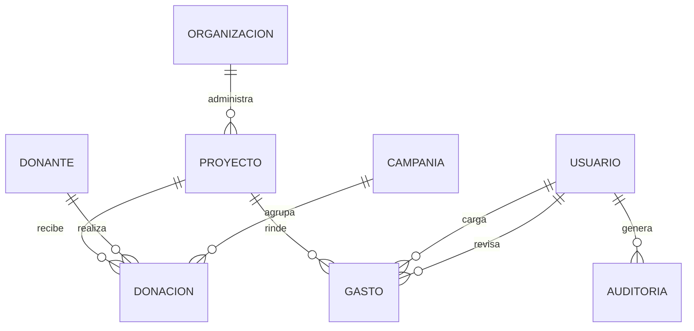
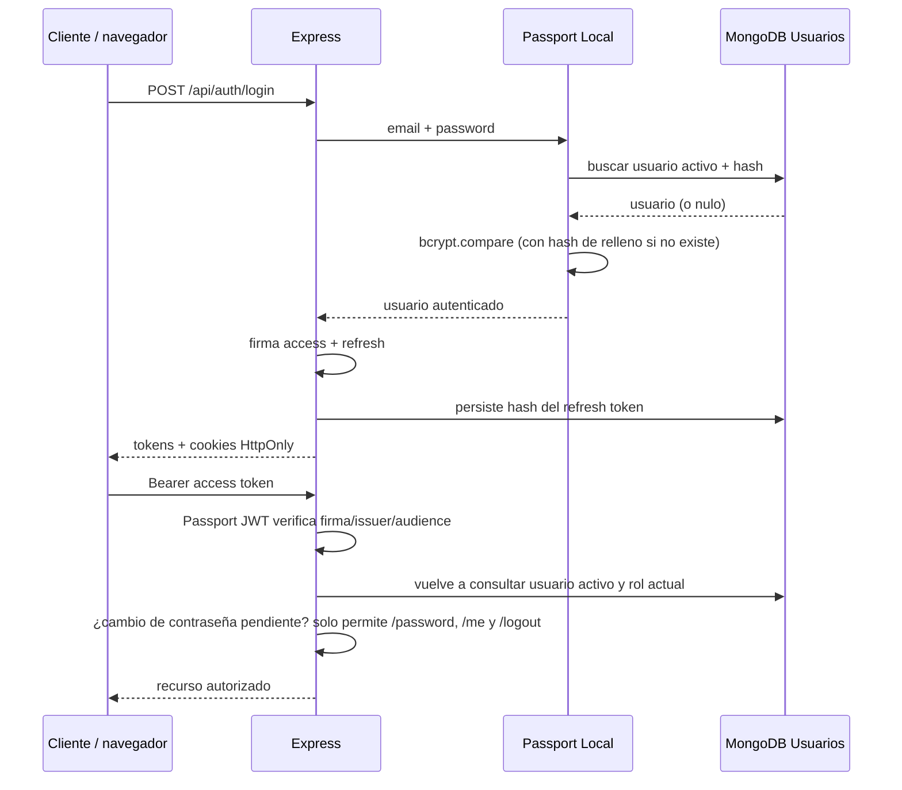
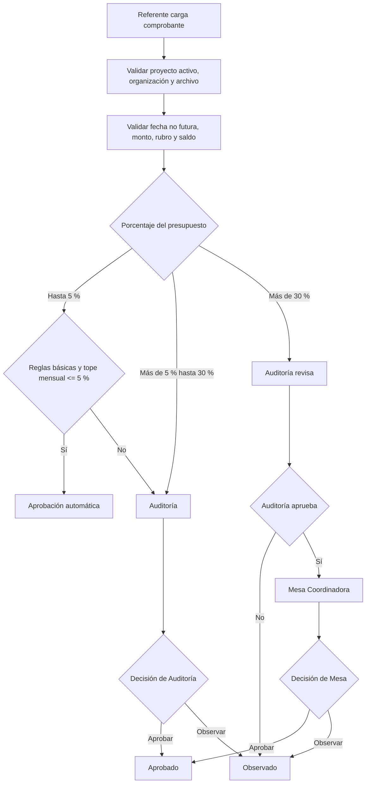

# Arquitectura y decisiones técnicas — SumarImpacto 1.2

## Contexto

El backend conserva Node.js + Express + MongoDB/Mongoose y vistas Pug. La API puede ser consumida por un
frontend independiente. La solución se organiza en MVC con una capa de servicios para que ni las rutas ni los
controladores contengan lógica de negocio, y la API y la interfaz web apliquen exactamente las mismas reglas.

## Componentes

- **Middleware transversal:** seguridad de cabeceras (CSP, no-cache), CORS, límites de tasa, sanitización de
  entrada, protección de origen y bitácora de auditoría. Se aplican una sola vez, antes de las rutas.
- **Routes:** definen endpoints, autenticación, permisos (`permitirGrupo`) y validación de entrada.
- **Controllers:** traducen HTTP a operaciones del dominio y preparan respuestas JSON o Pug.
- **Services:** reglas de negocio. `ProyectoService` (saldos, alcance por organización, ciclo de vida),
  `DonacionService`, `RendicionService` (circuito RF-02), `UsuarioService` (cuentas y contraseñas),
  `CampaniaService` (reportes) y `AuditoriaService` (bitácora).
- **Models:** persisten entidades y validaciones invariantes.
- **Utils:** funciones puras y sin dependencias de Express: política de contraseñas, reglas de rendición y de
  presupuesto, fechas, exclusión mutua y validadores.

### Orden de los middleware (`src/app.js`)

```mermaid
flowchart LR
  H[helmet + CSP] --> CO[CORS informativo] --> RL[Límite general] --> ST[Estáticos]
  ST --> NC[Cache-Control: no-store] --> P[Parsers + method-override]
  P --> AU[Bitácora] --> SA[Sanitización] --> OR[Protección de origen]
  OR --> PA[Passport] --> RT[Rutas] --> NF[404] --> EH[Errores]
```

Los estáticos se sirven antes de `no-store` (pueden cachearse). La **bitácora va antes de las defensas** para
registrar también lo que estas rechazan (origen no autorizado, estructura no permitida).

## Modelo de dominio

`Proyecto` registra presupuesto total, período, rubros y estado activo. `Gasto` representa una rendición
individual, con archivo, porcentaje de presupuesto, estado y actores de auditoría. `Auditoria` es el registro
de una acción (quién, qué, cuándo, desde dónde y con qué resultado) y nunca guarda cuerpos de solicitudes.

## Permisos

`src/config/permisos.js` es la **fuente única de verdad**. Define grupos de roles (por ejemplo
`LECTURA_FINANCIERA` o `REVISION_RENDICIONES`) que usan las rutas (`permitirGrupo`) y las vistas
(`puede("GRUPO")`). Un grupo inexistente lanza un error al iniciar, de modo que un error de tipeo nunca otorga
acceso. `permitirRoles` expone la propiedad `.roles`, lo que permite recorrer el router real y generar la
matriz de permisos (`npm run permisos`). Una prueba la compara con una referencia versionada para que ningún
cambio de permisos pase inadvertido.

| Recurso/acción | Referente | Auditoría | Mesa | Administración | Trabajo Social | Administrador |
| --- | ---: | ---: | ---: | ---: | ---: | ---: |
| Ver proyectos | Propios | Sí | Sí | Sí | Sí | Sí |
| Gestionar proyectos | No | No | Sí | No | Sí | Sí |
| Ver donantes y donaciones | No | Sí | Sí | Sí | No | Sí |
| Gestionar donantes y donaciones | No | No | No | Sí | No | Sí |
| Gestionar organizaciones | No | No | No | No | Sí | Sí |
| Cargar comprobantes | Propios | No | No | No | No | No |
| Ver rendiciones | Propias | Sí | Sí | Lectura | No | Lectura |
| Aprobar/observar 5–30 % | No | Sí | No | No | No | No |
| Revisar > 30 % | No | Sí | No | No | No | No |
| Resolver > 30 % | No | No | Sí | No | No | No |
| Gestionar usuarios | No | No | No | No | No | Sí |
| Consultar la bitácora | No | Sí | No | No | No | Sí |

## Autenticación

Passport JWT consulta el usuario en cada petición; no se confía en el rol embebido en el token. Esto permite
desactivar usuarios y modificar roles con efecto inmediato. Access token: 15 minutos. Refresh token: siete
días, con rotación; hay una sesión renovable por persona. El secreto JWT se resuelve en cada verificación y
**no tiene valor por defecto**.

Una cuenta con `debeCambiarPassword` solo puede usar `/perfil/password`, `/api/auth/password`, `/api/auth/me`
y los cierres de sesión; cualquier otra ruta redirige (web) o responde `403 PASSWORD_CHANGE_REQUIRED` (API).

## Flujo RF-02

Las reglas básicas son fecha dentro del período, rubro incluido en el presupuesto aprobado y monto no superior
al saldo. El porcentaje se calcula sobre `presupuestoTotal`. Los umbrales y el tope mensual se parametrizan en
`RENDICION_AUTO_MAX_PCT`, `RENDICION_MESA_MIN_PCT` y `RENDICION_AUTO_MONTHLY_CAP_PCT`. Los valores iniciales
(5 %, 30 % y 5 %) provienen de la elicitación y deben confirmarse con Mesa Coordinadora.

## Concurrencia

- **Saldo:** la verificación del saldo y la creación del gasto se ejecutan dentro de `conBloqueo(proyectoId)`
  (`utils/mutex.js`). Dos cargas simultáneas se serializan, de modo que la segunda ve el saldo ya descontado.
- **Revisión:** cada rendición se resuelve dentro de `conBloqueo("rendicion:<id>")` y el modelo `Gasto` usa
  `optimisticConcurrency`: si otra instancia modifica el documento entre la lectura y el guardado, Mongoose
  lanza `VersionError`, que el manejador de errores traduce a `409`.
- **Alcance:** la exclusión mutua protege una sola instancia del servidor; la concurrencia optimista protege
  también entre instancias. Para varias instancias convendría un bloqueo distribuido o transacciones de MongoDB
  (requieren un replica set).

## Consultas de saldo

`ProyectoService.calcularSaldos(ids)` obtiene donado, gastado aprobado y comprometido de **varios proyectos** con
tres consultas agregadas agrupadas por proyecto. Los listados y detalles la usan en lugar de calcular el saldo
proyecto por proyecto.

## Manejo de errores

Todos los controladores asincrónicos usan `asyncHandler`. Los errores de dominio usan `ApiError` con HTTP status
y código estable. El middleware final traduce errores de Mongoose, duplicados, concurrencia, JWT, JSON y Multer.
La API responde JSON uniforme; las vistas renderizan `views/error.pug` e incluyen el motivo concreto de una
validación. En producción no se exponen stack ni mensajes internos.

## Archivos adjuntos

Los comprobantes se reciben en memoria, se valida MIME + firma del archivo y se persisten como Buffer en el
documento MongoDB. Máximo 5 MB. Es adecuado para el volumen acotado de la entrega; para una instalación
productiva de gran escala conviene migrar los binarios a almacenamiento de objetos (S3/compatible) y conservar
en MongoDB metadatos y clave de objeto.

## Alcance: notificaciones por correo

Las notificaciones por correo a donantes (RF-03) no forman parte de esta versión. Se retiraron el módulo de
envío SMTP, la cola persistente de eventos y los enlaces públicos firmados a comprobantes para simplificar el
despliegue y reducir la superficie de ataque. Si se retoman, conviene implementarlas como un worker externo con
cola dedicada. Como consecuencia, la recuperación de contraseña la realiza un administrador.
