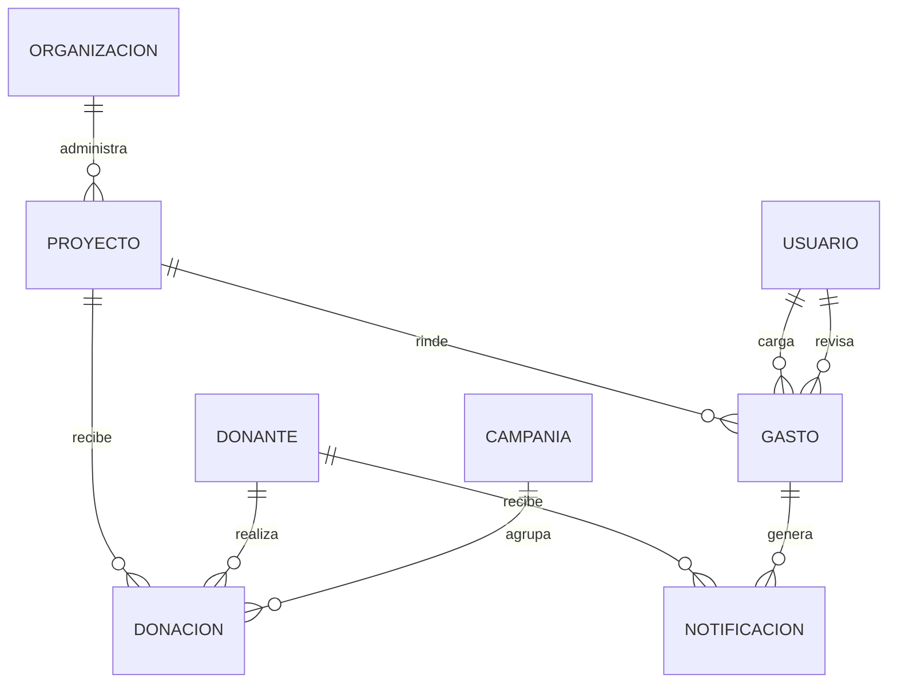
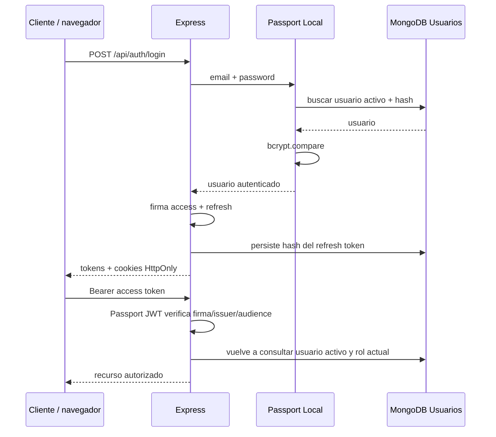
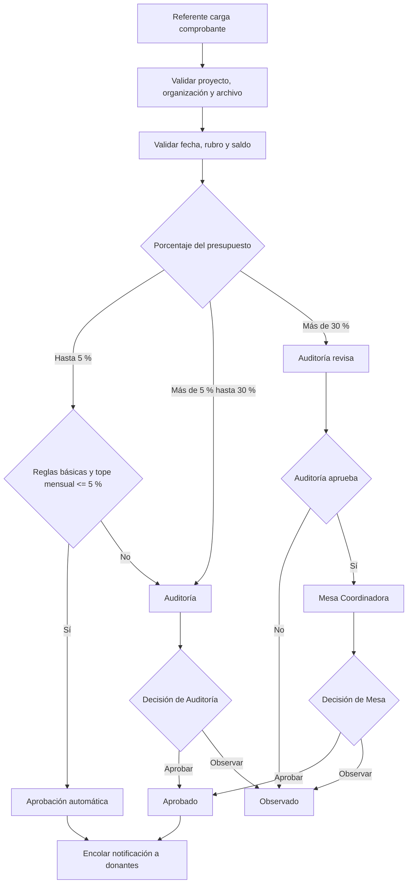

# Arquitectura y decisiones técnicas — SumarImpacto 1.1

## Contexto

El backend conserva Node.js + Express + MongoDB/Mongoose y vistas Pug de la versión anterior. La API puede ser consumida por un frontend independiente. La solución se organiza en MVC y una capa de servicios para evitar lógica de negocio dentro de las rutas.

## Componentes

- **Routes:** definen endpoints, autenticación, roles y validación de entrada.
- **Controllers:** traducen HTTP a operaciones del dominio y preparan respuestas JSON/Pug.
- **Services:** concentran reglas de saldo, validación de relaciones, aprobación de rendiciones y notificaciones.
- **Models:** persisten entidades y validaciones invariantes.
- **Middleware:** Passport JWT, control de roles, upload, normalización de errores, logging y seguridad HTTP.

## Modelo de dominio

`Proyecto` registra presupuesto total, período y rubros. `Gasto` representa una rendición individual, con archivo, porcentaje de presupuesto, estado y actores de auditoría. `Notificacion` funciona como outbox persistente para no perder eventos cuando el SMTP no está disponible.

## Autenticación

Passport JWT consulta el usuario en cada petición; no se confía en el rol embebido en el token para autorizar. Esto permite desactivar usuarios y modificar roles con efecto inmediato para nuevas peticiones. Access token: 15 minutos por defecto. Refresh token: siete días y rotación en cada uso.

## Flujo RF-02

Las reglas básicas son fecha dentro del período, rubro incluido en el presupuesto aprobado y monto no superior al saldo. El porcentaje se calcula sobre `presupuestoTotal`. Los umbrales y el tope mensual se parametrizan en `RENDICION_AUTO_MAX_PCT`, `RENDICION_MESA_MIN_PCT` y `RENDICION_AUTO_MONTHLY_CAP_PCT`. Los valores iniciales (5 %, 30 % y 5 %) provienen de la elicitación y deben confirmarse con Mesa Coordinadora.

## Autorización resumida

| Recurso/acción | Referente | Auditoría | Mesa | Administración | Trabajo Social | Administrador técnico |
|---|---:|---:|---:|---:|---:|---:|
| Ver proyectos | Propios | Todos | Todos | Todos | Todos | Todos |
| Cargar comprobantes | Propios | No | No | No | No | No |
| Ver rendiciones | Propias | Todas | Todas | Todas (lectura) | No | Todas (lectura) |
| Aprobar/observar 5–30 % | No | Sí | No | No | No | No |
| Revisar >30 % | No | Sí | No | No | No | No |
| Resolver >30 % | No | No | Sí | No | No | No |
| Gestionar organizaciones/proyectos | No | No | Sí (proyectos) | No | Sí | Sí |
| Gestionar usuarios | No | No | No | No | No | Sí |

El middleware de rol y las consultas con alcance por organización aplican esta matriz en servidor. El administrador técnico no suplanta las decisiones funcionales de Auditoría o Mesa.

## Manejo de errores

Todos los controladores asincrónicos usan `asyncHandler`. Los errores de dominio usan `ApiError` con HTTP status y código estable. El middleware final traduce errores de Mongoose, duplicados, JWT, JSON y Multer. API responde JSON uniforme; las vistas renderizan `views/error.pug`. En producción no se exponen stack ni mensajes internos.

## Archivos adjuntos

Los comprobantes se reciben en memoria, se valida MIME + firma del archivo y se persisten como Buffer en el documento MongoDB. Máximo 5 MB. Es adecuado para el volumen acotado de la entrega; para una instalación productiva de gran escala conviene migrar los binarios a almacenamiento de objetos (S3/compatible) y conservar en MongoDB metadatos y clave de objeto.

## Notificaciones

Al aprobarse una rendición se genera un registro persistente por donante que financió el proyecto. El worker agrupa eventos por destinatario y frecuencia. Los enlaces públicos a comprobantes se firman, expiran a los 90 días y solo sirven para rendiciones aprobadas. Los errores SMTP se reintentan tres veces con intervalos de cinco minutos. La cola actual es un worker integrado al proceso Node; la alta disponibilidad exige un worker externo y cola dedicada.
